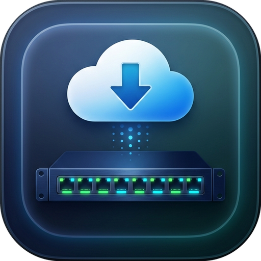
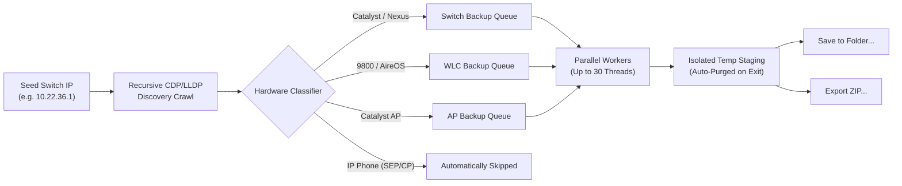

<div align="center">

<br/>



# Bulk Switch Backup Pro

### High-Performance Enterprise Network Switch Configuration & Topology Automation Engine

<br/>

[](https://github.com/LazyAutomatar/Bulk-Switch-Backup-Pro/releases)
[](#downloads)
[](#downloads)
[](#architecture)
[](#security)

<br/>

[**Downloads**](#downloads) · [**Features**](#features) · [**Distribution Model**](#distribution-model) · [**Quick Start**](#quick-start) · [**Security**](#security) · [**Author**](#author) · [**Disclaimer**](#disclaimer)

<br/>

</div>

> [!IMPORTANT]
> **Enterprise Safety Guarantee:** Bulk Switch Backup Pro runs strictly non-intrusive, read-only diagnostic and show commands (`show run`, `show version`, etc.) during discovery and crawl phases. IP Phones (`SEP*`, `CP-*`, `ATA`, `78xx`, `88xx`) are automatically identified and excluded from SSH probing. Switch state is never modified without explicit operator opt-in (`write memory` checkbox).

---

<div align="center">

<h1><a id="features"></a>Features</h1>

<table>
  <tr>
    <td width="50%" valign="top">

#### Network Discovery & Topology
- **Recursive CDP & LLDP Crawl** — Discovers your entire multi-tier switching fabric from a single seed switch.
- **Universal Multi-Token Port Tokenizer** — Full support for 25G `Twe` (TwentyFiveGigE), 100G `Hu`, 40G `Fo`, 10G `Ten`/`Te`, and 1G `Gig`/`Gi`.
- **Hierarchical Uplink Tracking** — Preserves parent switch linkage (Core $\rightarrow$ Distribution $\rightarrow$ Access) with live port-channel mapping.
- **Collision-Proof HostKey Engine** — Canonical hostname normalization (`HostKey.Same`) preventing neighbor drops across domain tags.
- **Multi-Command Telemetry Ingestion** — Combines `show cdp entry * protocols`, detailed CDP, tabular CDP, and LLDP detail without data loss.

#### Supported Hardware & Profiles
- **Cisco Catalyst Switches** — IOS and IOS-XE (2960, 3560, 3750, 3850, 9200, 9300, 9300X, 9400, 9500, 9600).
- **Cisco Nexus Switches** — NX-OS (N3K, N5K, N7K, N9K).
- **Cisco Wireless LAN Controllers** — Catalyst 9800 WLC (IOS-XE) & AireOS (5520, 8540, 3504).
- **Cisco Access Points** — Autonomous, Lightweight, and Catalyst APs (`AIR-AP`, `CW91`, `C9105/9115/9120/9130`).
- **Custom Command Profiles** — Define arbitrary diagnostic command batches.

    </td>
    <td width="50%" valign="top">

#### Performance & Concurrency Engine
- **High-Concurrency Async Workers** — Run parallel SSH backups across up to 30 simultaneous devices with thread throttling.
- **Multi-Credential Vault with Fallback** — AES-encrypted credential vault with automatic failover rotation on auth rejection.
- **Adaptive Privileged Escalation** — Intelligent `enable` prompt detection with secret injection and terminal paging suppression (`terminal length 0` / `config paging disable`).
- **Subnet & VLAN Filtering** — Scope discovery to specific CIDR subnets or management VLANs.

#### Modern Experience & Staging
- **Zero-Friction Temporary Staging** — Backups stage into an isolated temp workspace and auto-purge on exit.
- **On-Demand Export Options** — One-click **Save to Folder...** or **Export ZIP...** archive after execution.
- **Windows 11 Fluent UI** — FluentAvalonia 3-way dark/light theme sync, crisp dynamic scaling via `LayoutTransformControl`.
- **Cross-Platform Native Runtime** — Pre-compiled self-contained native builds for Windows, macOS, and Linux.

    </td>
  </tr>
</table>

</div>

---

<div align="center">

<h1><a id="distribution-model"></a>Distribution & Collaboration Model</h1>

</div>

> [!NOTE]
> **Closed-Source Core Engine · 100% Free & Publicly Distributable Release Packages**  
> Bulk Switch Backup Pro is engineered as an enterprise-grade commercial utility with a **closed-source core engine**, while providing **completely free, public, pre-compiled release packages** for the network community.
> 
> - **Free Public Releases:** Download and run on unlimited production switches with no license keys, timeouts, or telemetry tracking.
> - **Open Public Collaboration:** Community issue tracking, feature requests, device profile templates, and test matrices are managed openly in this repository.
> - **Enterprise Code Hardening:** Every public binary is compiled with ASLR, DEP, deterministic builds, and cryptographic SHA-256 signatures.

---

<div align="center">

<h1><a id="downloads"></a>Downloads & Installation</h1>

<a href="https://github.com/LazyAutomatar/Bulk-Switch-Backup-Pro/releases" target="_blank" rel="noopener noreferrer"></a>
<a href="https://github.com/LazyAutomatar/Bulk-Switch-Backup-Pro/releases" target="_blank" rel="noopener noreferrer"></a>
<a href="https://github.com/LazyAutomatar/Bulk-Switch-Backup-Pro/releases" target="_blank" rel="noopener noreferrer"></a>

<br/><br/>

### Public Release Artifacts (v3.0.1 Enterprise)

| Platform | Architecture | Package Format | Download Link | SHA-256 Checksum |
| :--- | :--- | :--- | :--- | :--- |
| **Windows** | x64 (64-bit) | Standalone Executable | [`BulkSwitchBackupPro.exe`](https://github.com/LazyAutomatar/Bulk-Switch-Backup-Pro/releases/latest/download/BulkSwitchBackupPro.exe) | See release checksums |
| **Windows** | x64 (64-bit) | Windows Setup Wizard | [`BulkSwitchBackupPro_Setup.exe`](https://github.com/LazyAutomatar/Bulk-Switch-Backup-Pro/releases/latest/download/BulkSwitchBackupPro_Setup.exe) | See release checksums |
| **Windows** | x64 (64-bit) | Portable ZIP Archive | [`BulkSwitchBackupPro-win-x64.zip`](https://github.com/LazyAutomatar/Bulk-Switch-Backup-Pro/releases/latest/download/BulkSwitchBackupPro-win-x64.zip) | See release checksums |
| **macOS** | Apple Silicon (M1–M4) | Native `.app` (ZIP) | [`BulkSwitchBackupPro-osx-arm64.zip`](https://github.com/LazyAutomatar/Bulk-Switch-Backup-Pro/releases/latest/download/BulkSwitchBackupPro-osx-arm64.zip) | See release checksums |
| **macOS** | Intel x64 | Native `.app` (ZIP) | [`BulkSwitchBackupPro-osx-x64.zip`](https://github.com/LazyAutomatar/Bulk-Switch-Backup-Pro/releases/latest/download/BulkSwitchBackupPro-osx-x64.zip) | See release checksums |
| **Linux** | x64 (64-bit) | Native Binary + Desktop | [`BulkSwitchBackupPro-linux-x64.tar.gz`](https://github.com/LazyAutomatar/Bulk-Switch-Backup-Pro/releases/latest/download/BulkSwitchBackupPro-linux-x64.tar.gz) | See release checksums |
| **Linux** | ARM64 | Native Binary + Desktop | [`BulkSwitchBackupPro-linux-arm64.tar.gz`](https://github.com/LazyAutomatar/Bulk-Switch-Backup-Pro/releases/latest/download/BulkSwitchBackupPro-linux-arm64.tar.gz) | See release checksums |

</div>

#### Linux Installation:
Extract the `.tar.gz` and run the included desktop installer:
```bash
tar -xzf BulkSwitchBackupPro-linux-x64.tar.gz
cd BulkSwitchBackupPro-linux-x64
chmod +x install.sh BulkSwitchBackupPro
./install.sh
```

#### macOS Installation:
Extract the `.zip`, drag `BulkSwitchBackupPro.app` to `/Applications`, and open.

---

<div align="center">

<h1><a id="quick-start"></a>Quick Start & Workflow</h1>

</div>



1. **Input Seed Switch or IP List**:
   - Provide your seed Core/Distribution switch IP address (or import a batch IP list from text file).
2. **Configure Multi-Credential Vault**:
   - Enter your primary network credentials and enable secret. Add fallback credentials to the encrypted vault.
3. **Select Execution Profile**:
   - Choose from **Cisco Switch (IOS / IOS-XE)**, **Cisco Nexus (NX-OS)**, **Cisco Catalyst 9800 WLC**, **Cisco AireOS WLC**, or **Custom Profile**.
4. **Initiate Traversal & Backup**:
   - Click **Start Backup**. The engine recursively maps the network topology, classifies hardware, captures configurations concurrently, and logs status in real time.
5. **Export On Demand**:
   - Backups are safely staged in temporary isolation. Click **Save to Folder...** to persist to your local directory or **Export ZIP...** to download a compressed archive.

---

<div align="center">

<h1><a id="security"></a>Enterprise Security Hardening</h1>

</div>

Bulk Switch Backup Pro is engineered to meet strict corporate cybersecurity standards for enterprise management utilities:

- **Address Space Layout Randomization (ASLR):** Compiled with `HighEntropyVA=true` preventing memory injection attacks.
- **Data Execution Prevention (DEP):** Strict hardware-enforced code execution boundaries.
- **Cryptographic Release Verification:** Integrated auto-updater verifies SHA-256 hashes against trusted release manifests prior to staging or execution.
- **Least-Privilege UAC (`asInvoker`):** The application runs strictly with standard user privileges and never prompts for elevated administrator permissions during normal operation.
- **Zero-Footprint Session Staging:** Output files remain in isolated temporary storage and are purged automatically upon process termination unless explicitly saved by the user.

---

<div align="center">

<h1><a id="support"></a>Community & Collaboration</h1>

We welcome community feedback, feature requests, and issue reports!

[**Report Bug / Issue**](https://github.com/LazyAutomatar/Bulk-Switch-Backup-Pro/issues) · [**Request Feature**](https://github.com/LazyAutomatar/Bulk-Switch-Backup-Pro/issues) · [**Command Profile Proposals**](https://github.com/LazyAutomatar/Bulk-Switch-Backup-Pro/discussions)

</div>

---

<div align="center">

<h1><a id="author"></a>Author & Attribution</h1>

Designed and engineered by **Yash Nalawde** (Independent Developer)

[](https://www.linkedin.com/in/yash-nalawde)
[](https://github.com/Majordean0303)

</div>

---

<div align="center">

<h1><a id="disclaimer"></a>Disclaimer & Legal Notice</h1>

Bulk Switch Backup Pro is an independent network administration and automation utility.

- **Non-Affiliation:** Cisco, Cisco Catalyst, Cisco Nexus, Cisco AireOS, Cisco IOS, Cisco IOS-XE, and Cisco Aironet are registered trademarks of Cisco Systems, Inc. This project is not affiliated with, endorsed by, or sponsored by Cisco Systems, Inc.
- **Operational Responsibility:** While this application incorporates strict safety mechanisms (including IP phone exclusions, paging suppression, and read-only diagnostic commands), network administrators are solely responsible for verifying command sets against their corporate change control policies before execution on production campus and datacenter networks.

</div>

## Migration development checks

Development targets the .NET 10 SDK and PowerShell 7. Run
`./scripts/test-core.ps1` for offline core tests, or `./scripts/test-all.ps1`
for the full core gate followed by an Avalonia desktop build. Use
`-Filter 'FullyQualifiedName~Cancellation' -NoRestore` on the core runner for
focused checks. Detailed validation logs and TRX results are stored under ignored
`artifacts/`; no matching tests is a failing result.

Read [MIGRATION_STATE.md](MIGRATION_STATE.md) for the current checkpoint and next
bounded task, [MIGRATION_ROADMAP.md](MIGRATION_ROADMAP.md) for the serial app
sequence, and [CHANGELOG.md](CHANGELOG.md) for this app's changes.


## Multi-vendor automatic backup

Auto-detect is the default command profile. Each backup identifies the device OS
before choosing commands and records rejected commands instead of treating them
as successful captures. See [platform support and validation](PLATFORM_SUPPORT.md)
for the supported OS families, Cisco/WLC corrections, custom-script behavior and
live-device acceptance checklist.

## Review changes before upgrading

Open **About** and expand **Release Changelog & History** to read the installed
release history without an internet connection. **Check for Updates** displays
complete notes for the available version and adds it to the history. On Windows,
choose **Review Update**, read the version and upgrade details, then select
**Download & Install** to proceed or **Cancel** to stay on the current version.
No package is downloaded or launched by checking updates or opening the changelog.
Save completed backup exports before installing. On macOS/Linux, use **Open Release
Downloads** and choose the matching package.

## Command Results and partial diagnostics

After a run, **Command Results** lists failed command attempts, including device IP,
hostname, command and the returned error. Filter the list and select a row to read
its response, or export the failed-command list as JSON. A rejected attempt may
appear even if its fallback syntax later succeeds.

Working commands continue after CLI rejections. When required configuration output
is unavailable, captured diagnostics are saved as `*.partial-diagnostics.txt` and
can be exported with the other backup files. These files are incomplete diagnostics,
not complete configuration backups; earlier complete backups remain untouched.
A timeout with an incomplete prompt ends that device session to avoid mixing outputs,
while retaining diagnostic commands captured before the failure.

For wide result tables, use the wheel over the horizontal scrollbar, or hold
**Shift** while wheeling over the table. Normal vertical scrolling is preserved.

## Windows code signing

Public Windows packaging now requires a trusted code-signing certificate and a
verified timestamp. Configure GitHub Actions secrets `WINDOWS_SIGNING_PFX_BASE64`
and `WINDOWS_SIGNING_PFX_PASSWORD` for a CA-issued PFX whose private key is permitted
to be used this way. Local production packaging accepts `CERT_PATH`/`CERT_PASS`,
or `SIGNING_CERT_THUMBPRINT` for an existing CurrentUser signing identity.
Keep private keys out of the repository; hardware-backed or managed signing
identities need their provider integration rather than an exported PFX.

The application is signed before it is copied into the portable ZIP and installer.
The setup executable is signed before the update manifest's checksum is generated.
Missing credentials, self-signed production identities, or invalid/missing production
timestamps stop publication. The release workflow removes its temporary PFX afterward.

For a local beta only, run `./scripts/build-signed-beta-installer.ps1
-AllowDevelopmentCertificate` after building the portable beta. It reuses the
existing Bulk Switch Backup development certificate and uses a separate install
folder, application identity and shortcuts. It never imports a trusted root or
changes SmartScreen settings. Its public `.cer` file is for inspection, not an
instruction to trust it on other computers. Self-signed installers can still trigger
warnings; publicly trusted signatures also need SmartScreen reputation.

See [Microsoft's SmartScreen guidance](https://learn.microsoft.com/windows/apps/package-and-deploy/smartscreen-reputation).
