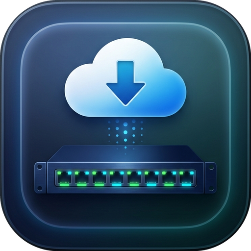
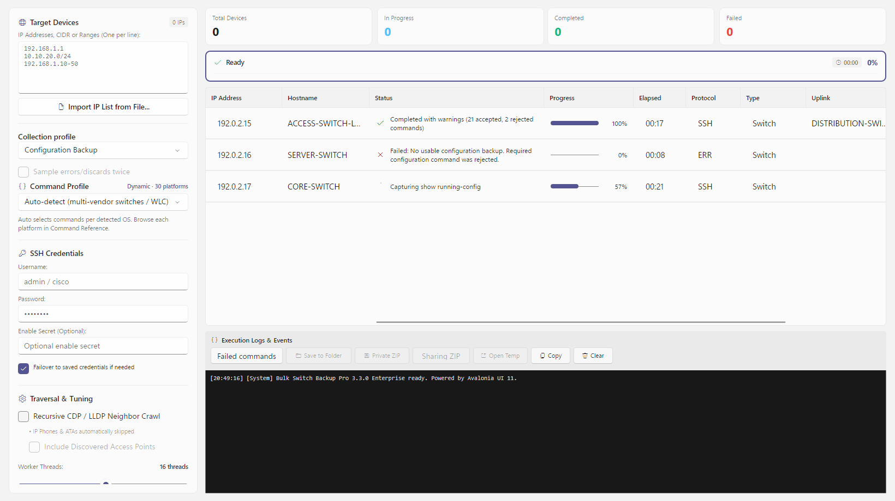
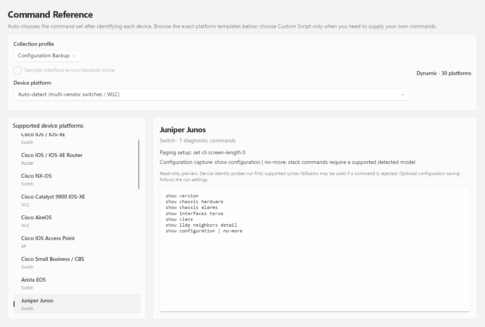
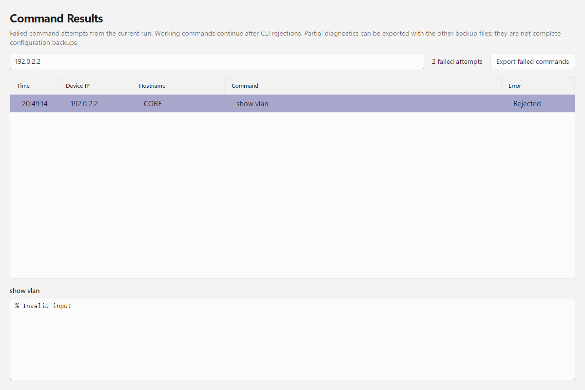

# Bulk Switch Backup Pro

[](CHANGELOG.md)
[](#downloads)
[](EULA.txt)
[](#author)

---

Back up a managed switch, router, wireless controller, or access point from one desktop. Give the app a management address and CLI credentials. It collects the configuration and diagnostics into per-device text files, then packages them with a manifest that tells you **which devices answered, which commands worked, and what evidence is missing**. Network administrators can keep the raw backup for recovery or prepare a redacted copy for troubleshooting and Network Health Reporter.

[Downloads](#downloads) · [First backup](#quick-start) · [Feature guide](#feature-guide) · [Command Reference](#command-reference) · [Failed commands](#results) · [ZIP exports](#exports) · [Support](#support)



*Run & Monitor in v3.4.0, with synthetic device rows. The first switch reached 100% with two rejected commands. Read the Status column before treating a finished run as a complete capture.*

> [!NOTE]
> **What's New in v3.4.0** (27 November 2026)
> - **Automatic Background Update Check**: Checks for new releases automatically on startup and shows a clickable **Update** pill in the title bar when a newer version is available.
> - **Hardened Silent Updater**: Verifies official download origin and SHA-256 checksums before upgrading silently in the background and relaunching automatically.
> - **Dedicated Cisco Router & Expanded Catalyst Support**: Automatic recognition of Cisco routers plus full interface/transceiver, MAC count, and stack-port diagnostics.
> - **Subnets, IP Ranges & Encrypted Vault**: Enter entire subnets and ranges directly in the target list, and reuse logins across Windows, macOS, and Linux.
>
> See the full [Changelog](CHANGELOG.md) for complete release details.

## Feature guide

| If you want to… | Open this part of the app | What to look for |
| --- | --- | --- |
| Back up a list or subnet | **Run & Monitor → Target Devices** | [Addresses, ranges, CIDR and file import](#target-formats) |
| Find which switch and port an AP uses | **Run & Monitor → Recursive CDP / LLDP Neighbor Crawl** | [Neighbor discovery, AP inclusion and missing IPs](#discover-devices-from-a-seed) |
| See which commands Auto will try for a device family | **Command Reference → Supported device platforms** | [Command palettes and model-specific commands](#command-reference) |
| Collect a site-specific set of commands | **Command Reference → Custom CLI Command Script** | [Editable script and a four-command example](#custom-cli-scripts) |
| Reuse logins across runs | **Saved Credentials** | [Vault setup, credential fallback and migration](#security) |
| Explain a warning or a missing configuration | **Run & Monitor → Failed commands** | [Per-device inspection, command outcomes and JSON failure reports](#results) |
| Keep a recovery copy or send diagnostics to another engineer | **Run & Monitor → Private ZIP / Sharing ZIP** | [Export choices](#exports) and [a before-and-after redaction example](#sharing-zip-redaction) |
| Check what an upgrade changes | **About & System** | [Installed changelog and incoming release notes](#review-changes-before-upgrading) |

<a id="downloads"></a>

## Download and install

Choose the package for the computer **running the backups**. Everything needed to run the app is included—no extra runtime installation is required. Your network devices just need to be reachable over SSH or Telnet with an account that can read configurations and diagnostics.

| Collector | Package from the v3.4.0 release | How to start |
| --- | --- | --- |
| Windows x64 | [Setup wizard](https://github.com/LazyAutomatar/Bulk-Switch-Backup-Pro/releases/download/v3.4.0/BulkSwitchBackupPro_Setup.exe) | Run the installer, then open **Bulk Switch Backup Pro** from Start. |
| Windows x64, portable | [Portable ZIP](https://github.com/LazyAutomatar/Bulk-Switch-Backup-Pro/releases/download/v3.4.0/BulkSwitchBackupPro-win-x64.zip) or [standalone EXE](https://github.com/LazyAutomatar/Bulk-Switch-Backup-Pro/releases/download/v3.4.0/BulkSwitchBackupPro.exe) | Extract the ZIP and run `BulkSwitchBackupPro.exe`, or run the standalone executable. |
| macOS | [Apple Silicon](https://github.com/LazyAutomatar/Bulk-Switch-Backup-Pro/releases/download/v3.4.0/BulkSwitchBackupPro-osx-arm64.zip) · [Intel](https://github.com/LazyAutomatar/Bulk-Switch-Backup-Pro/releases/download/v3.4.0/BulkSwitchBackupPro-osx-x64.zip) | Extract the ZIP and move `BulkSwitchBackupPro.app` into Applications. |
| Linux | [x64](https://github.com/LazyAutomatar/Bulk-Switch-Backup-Pro/releases/download/v3.4.0/BulkSwitchBackupPro-linux-x64.tar.gz) · [ARM64](https://github.com/LazyAutomatar/Bulk-Switch-Backup-Pro/releases/download/v3.4.0/BulkSwitchBackupPro-linux-arm64.tar.gz) | Extract the archive and run the included binary or install the application menu entry as shown below. |

<details>
<summary>Linux launch and desktop installation</summary>

For the x64 package, run these commands from the download directory. Substitute `linux-arm64` in both paths for ARM64.

```sh
tar -xzf BulkSwitchBackupPro-linux-x64.tar.gz
cd linux-x64
chmod +x BulkSwitchBackupPro
./BulkSwitchBackupPro
```

For a system-wide install, run `sudo bash ./install.sh` from the extracted directory. The installer places the app under `/opt/bulkswitchbackuppro` and adds the `bulkswitchbackuppro` launcher.

</details>

<details>
<summary>Silent installation and Windows signing</summary>

Download the [silent installation launcher](https://github.com/LazyAutomatar/Bulk-Switch-Backup-Pro/releases/download/v3.4.0/BulkSwitchBackupPro_Install_Silent.cmd) into the same folder as `BulkSwitchBackupPro_Setup.exe`. Run the launcher from PowerShell.

```powershell
.\BulkSwitchBackupPro_Install_Silent.cmd
$LASTEXITCODE
```

The launcher waits for setup, returns its exit code, and writes `%TEMP%\BulkSwitchBackupPro-Silent-Install.log`. Its optional arguments are the installer path, installation directory, and log path, in that order.

The v3.4.0 Windows executable and installer carry Yash Nalawde publisher metadata and a timestamped self-signed signature. Windows may display SmartScreen or Unknown Publisher warnings. To check the installer download, compare `Get-FileHash .\BulkSwitchBackupPro_Setup.exe -Algorithm SHA256` with the `sha256` field in the [v3.4.0 update manifest](https://github.com/LazyAutomatar/Bulk-Switch-Backup-Pro/releases/download/v3.4.0/update_manifest.json).

</details>

<a id="quick-start"></a>

## Run your first backup

```text
┌───────────────────────┐      ┌─────────────────────────┐      ┌─────────────────────────┐
│ 1. Define Targets     │ ───► │ 2. Parallel Collection  │ ───► │ 3. Verify & Export      │
│ IPs, CIDR, Range, Seed│      │ SSH / Telnet (1-30 th.) │      │ Private/Sharing ZIP     │
│ Optional Subnet Filter│      │ Identity & CLI Discovery│      │ Manifest & JSON Errors  │
└───────────────────────┘      └─────────────────────────┘      └─────────────────────────┘
```

The worked example uses **WLC-9800** at **192.0.2.1**, a documentation address. Substitute the management address of a controller or switch you administer.

1. Open **Run & Monitor**. Under **Target Devices**, enter the management address. Leave **Recursive CDP / LLDP Neighbor Crawl** off for this single-device run.
2. Keep **Command Profile** on **Auto-detect (multi-vendor switches / WLC)**. Auto inspects the device identity and selects the commands for that platform. Open **Command Reference** from the side menu to preview the plan.
3. Enter **Username** and **Password**. Supply an **Enable Secret** if the device requires it to read privileged output. Leave **Write running-config to startup** unchecked for an ordinary backup.
4. Click **Start Backup**. Follow the device’s **Protocol**, **Elapsed**, and **Status**. If a command is rejected, open **Failed commands** above the log to inspect the CLI response.
5. Click **Private ZIP** to keep the raw capture. Open the ZIP and look for the device text file and `capture-manifest.json`. Export before closing the app because the default session directory is temporary.

### Target formats

| Input method | Example | What the collector does |
| --- | --- | --- |
| Individual target | `192.0.2.1` | Queues the address. Enter one target per line for an easy-to-review list. |
| IPv4 CIDR | `192.0.2.8/30` | Queues `192.0.2.9` and `192.0.2.10`. The target parser supports /20 through /32. A /31 includes both addresses. |
| Inclusive range | `192.0.2.10-12` or `192.0.2.10-192.0.2.12` | Queues .10, .11 and .12. Overlapping entries are deduplicated. |
| **Import IP List from File...** | A TXT or CSV file containing `192.0.2.1` | Replaces the target list with distinct IPv4 address strings found anywhere in the file. No header is required. Enter CIDR and range expressions directly in the target box for expansion. |

### Discover devices from a seed

Start with a switch you administer, enable **Recursive CDP / LLDP Neighbor Crawl**, and set **Discovery Subnet Filter (Optional)** to the management network you intend to collect. Enable **Include Discovered Access Points** for AP inventory and backup. Both discovery and AP inclusion start off.

For example, suppose `SW-01` advertises `AP-01` on its local `Gi1/0/8`, with remote port `GigabitEthernet0` and management IP `192.0.2.20`. The AP row gives you two different ways to investigate it. **Uplink** and **Port Link** identify the switch and wired port to inspect for link or power problems. The **IP Address** lets the collector open a separate session to the AP for its own wired-interface, radio and CAPWAP output. A WLC capture supplies the controller’s view of APs and clients.

| What the seed reports | What happens during discovery and backup |
| --- | --- |
| A neighboring switch with a usable management IPv4 address | The collector queues the switch and checks its neighbors in turn. Repeated sightings of the same address share a traversal entry. |
| A recognized AP with a usable management IPv4 address | With AP inclusion enabled, the collector queues an AP backup. Traversal stops at the AP. |
| A device name and ports, with no usable address | The collector retains the eligible neighbor in inventory. A later matching advertisement can supply the address. If none does, the device has no CLI capture. You can enter a separately verified management address as a target. |
| A phone, endpoint or neighbor with insufficient infrastructure evidence | The collector skips the advertised neighbor before attempting a login. |

**Catalyst 1000 and SG/SF/CBS switches participate in traversal.** The collector combines the CDP summary (device and ports), detailed CDP records, CDP protocol address output and LLDP detail. It handles wrapped switch and port names. On Small Business switches it also tries `show cdp entry *` when detailed neighbor records are missing. A rejected optional lookup appears in the log and the other lookups continue. Discovery coverage depends on what the switch advertises and which output formats the collector recognizes.

**Worker Threads** controls parallel device collection from 1 to 30. Its initial value is twice the collector’s processor count, bounded between 6 and 16. **Execution Logs & Events** shows connection and command progress as it happens.

<a id="features"></a>

## Choose a collection mode and device profile

| Goal | Selection | What you get |
| --- | --- | --- |
| Keep configurations & diagnostics | **Auto-detect** | Platform-specific diagnostics plus the required configuration command. Saving running configuration to startup is a separate opt-in on supported devices. |
| Supply your own diagnostics | **Custom CLI Command Script** | Edit the commands in **Command Reference**. Review them for the device family and account privileges before starting. |

### Command Reference

In **Command Reference**, select **Auto-detect (multi-vendor switches / WLC)** and choose a family under **Supported device platforms**. The panel shows its device type, diagnostic command count, paging setup, configuration capture command and ordered command list. Selecting a family here changes the preview. During a run, the collector reads identity evidence from each device and builds its actual command list. Auto stops after identification if it cannot recognize the OS.



For example, the Junos palette uses `set cli screen-length 0` for paging and `show configuration | no-more` for configuration. An IOS switch uses `terminal length 0` and `show running-config`. The four named Cisco templates in the selector are read-only starting points. Built-in runs still adapt to the detected device. Stack commands in the preview require a supported model at capture time.

| Cisco family | Commands | Evidence to look for |
| --- | :---: | --- |
| Catalyst IOS/IOS-XE Switches | **88** | Full interface status & transceiver diagnostics, CPU/memory sorted stats, environment power/fans/temperature, MAC address table count, CDP/LLDP neighbors, and spanning-tree root/inconsistent ports. Stack models get stack detail, ring speed, stack-power, stackwise-virtual, and stack-ports summary. |
| Catalyst 9800 WLC | **62** | Chassis HA & RMI, AP fleet general config, image versions, RF profiles, CleanAir channels, transmit power, client delete reasons, transceivers, AAA servers, and PKI certificates. |
| Cisco Nexus (NX-OS) | **20** | System resources, environment, port channels, interface error counters, neighbor detail, logging logfile, and running/startup configurations. |
| Cisco AireOS Controllers | **20** | Joined APs, AP join statistics, client summary, WLANs, rogue devices, and mobility telemetry. Configuration command: `show run-config commands`. |
| Recognized IOS/IOS-XE Routers | **7** | Version, hardware inventory, IPv4 interface brief, both CDP neighbor views (detail and summary), running-config, and startup-config. |
| Cisco Access Points | **8** | `show interfaces wired 0` uplink, `show capwap client rcb` and `config`, radio controllers, inventory, and `show run`. |
| Catalyst 1000 and SG/SF/CBS | **88** / Switch | Shared switch diagnostics including inventory, interface status, and both CDP views. C1000 uses IOS paging; Small Business switches use `terminal datadump`. Both execute switch command plans. |
| Custom CLI Default Template | **10** | Default customizable starter template including sorted CPU, sorted memory, temperatures, and hardware CPU policer diagnostics. |

The 30 palettes also cover Arista EOS, Juniper Junos, Aruba AOS-CX and ProVision, HPE/H3C Comware, Huawei VRP, Dell OS10/OS9/OS6, Extreme EXOS and VOSS, Ruckus/Brocade FastIron, Alcatel-Lucent OmniSwitch, FortiSwitchOS, MikroTik RouterOS, NETGEAR, D-Link, TP-Link, Ubiquiti EdgeSwitch, AlliedWare Plus, Ruijie RGOS, ZTE ZXR10 and SONiC. The platform matrix lists the configuration command for each family. [Platform support matrix](docs/PLATFORM_SUPPORT.md)

### Custom CLI scripts

1. Choose **Configuration Backup → Custom CLI Command Script**. Open **Command Reference** and enter one command per line. Blank lines and lines starting with `!` are ignored. **Clear** empties the working list and **Reset template** reloads the supplied example.
2. For a short IOS switch backup, enter the block below. Use devices that accept the same CLI syntax for that run.

   ```text
   ! IOS switch identity, interface addresses and configuration
   show version
   show inventory
   show ip interface brief
   show running-config
   ```

3. Start the backup from **Run & Monitor**. The collector probes the device identity, applies its known paging setup, and attempts your permitted commands in order. An explicitly targeted device with an unrecognized OS can run a reviewed custom script. APs added by discovery receive the AP command list. Recognized configuration-change commands are suppressed and logged.
4. Include the platform’s configuration command when you need a recovery copy. A script containing only successful diagnostics can produce a file with `configurationCaptured` set to `false`. To persist a supported device’s running configuration to startup, explicitly select **Write running-config to startup**.

<a id="security"></a>

## Connect with session or saved credentials

For a single run, enter a username, password and optional enable secret in **Run & Monitor**. For reuse across runs on Windows, macOS or Linux, open **Saved Credentials**. The vault starts locked. A new master password requires at least 12 characters and has no recovery mechanism.

| Vault control | When to use it |
| --- | --- |
| **Create / Unlock Vault → Save Credential** | Give a login a recognizable label, such as *Branch switches*. Save the device username, password and optional enable secret. |
| **Apply to Session** or **Quick Preset (Unlocked Vault)** | Fill the active session fields with one chosen login directly from Run & Monitor. |
| **Failover to saved credentials if needed** | Allow the collector to try additional logins from the unlocked pool after the active login fails. Clear this option when only the selected account should be tried. |
| **Lock Vault** or **Delete** | Locking clears active credential fields and wipes key material from RAM. Delete removes the selected preset. |
| **Forgot Password? Erase & Reset Vault** | Completely erases an inaccessible vault and reinitializes clean storage if the master password is lost. |

Your saved logins are stored in a portable, password-protected encrypted vault—no cloud account is required, and it works identically across Windows, macOS, and Linux. Sensitive login details are cleared from memory as soon as you lock the vault or close the app. To move your saved logins to another computer, copy `BulkSwitchBackupPro/Credentials/vault.json` from your user application-data folder (`%APPDATA%` on Windows, `~/.config` on Linux/macOS) to the target machine and unlock it with the same master password.

The collector tries SSH on port 22 first. A connection or negotiation failure can trigger Telnet on port 23. Telnet carries credentials and device output in clear text, so use it on a trusted management network. An SSH authentication rejection advances to the next available credential. The **Protocol** column identifies the connection actually used.

Older switches can present a second `Username:` and `Password:` after the initial `login:` exchange. The collector handles repeated prompts with a bounded retry count and waits for a device prompt before sending backup commands. A rejected login or password-change prompt ends that login attempt.

<a id="results"></a>

## Read a result and investigate a failure

**Run & Monitor** displays total devices, devices in progress, completed devices, and failures alongside a live session timer. Use **Elapsed** and **Status** to follow each device's progress in real time. **Cancel Backup** signals active workers to stop gracefully.

The results table lets you resize columns, keeps key columns visible while scrolling, and includes built-in vertical and horizontal scrollbars. Right-click any device row to access quick actions:
* **Inspect Failed Commands**: Instantly opens Command Results filtered specifically to that device.
* **Copy IP Address**: Copies the device management IP address to your clipboard.
* **Copy Hostname**: Copies the resolved device hostname to your clipboard.

On smaller screens, roll the mouse wheel over the horizontal scrollbar or hold **Shift + mouse wheel** to view **Uplink** and **Port Link** columns. Use the zoom controls in the title bar or keyboard shortcuts (<kbd>Ctrl</kbd> + <kbd>+</kbd>, <kbd>Ctrl</kbd> + <kbd>−</kbd>, and <kbd>Ctrl</kbd> + <kbd>0</kbd>) to resize the interface.

| Device result | What to check next |
| --- | --- |
| Completed | Open the device text file for the captured configuration and diagnostic command headers. |
| Completed with warnings | Check the manifest’s `configurationCaptured` flag and each command outcome. A device can reach 100% while individual diagnostics are missing. |
| Partial diagnostics saved | Other commands succeeded but the required configuration was unusable. The `.partial-diagnostics.txt` file contains the surviving evidence. An earlier complete backup is preserved. |
| No usable configuration backup was captured | No command in the capture plan produced usable output. Check the login, privileges and device responses before trying again. |
| Unreachable or skipped | Check management addressing, transport, and discovery settings. The current manifest can record a target without an output file. |

### Inspect and export failed commands

1. When a run ends with command failures, the app opens **Command Results** for the whole run. To investigate one device, select its row in **Run & Monitor** and choose **Inspect Failed Commands** from the context menu. **Failed commands** above the log also uses the selected device’s IP. Clear the search box to see all failures again. The context menu also offers **Copy IP Address** and **Copy Hostname**.
2. Search by IP, hostname, command or error. Select a row for its time, command, error and device response. Each response in this view is limited to 4,000 characters. The device text file and manifest hold the underlying capture.
3. Choose **Export failed commands** before starting another backup. It writes `failed-commands.json` with **all failures from the current run**, including rows outside the active filter. This separate report can contain raw device text. To send redacted evidence, use **Sharing ZIP**.

**Execution Logs & Events** shows the connection, discovery and command sequence. **Copy** copies the event log and **Clear** clears its display. For a command-by-command audit, open the device’s manifest record. It preserves the requested command and each actual attempt, including a rejected spelling followed by a successful equivalent.

| Manifest command outcome | How to interpret it |
| --- | --- |
| `accepted` | The output passed the command’s completion checks. For IOS, recognized IOS routers and Catalyst 9800 running configuration, these include a returned prompt and trailing `end`. |
| `unsupported` or `unauthorized` | Inspect the device response for a syntax or privilege error. The collector tries a defined equivalent where available and continues with other commands. |
| `empty`, `timedOut` or `truncated` | The output was missing or incomplete. After a session error the collector attempts a fresh connection for later commands. The per-command capture limit is 32 MiB. |
| `failed`, `cancelled` or `notAttempted` | Read the reason and timestamps to see where collection stopped and which evidence is missing. |

<details>
<summary>See a rejected command in the desktop app</summary>



The selected switch returned `% Invalid input` for `show vlan`. Other commands on that switch can still produce a usable configuration backup.

</details>

<a id="exports"></a>

## Export and read a snapshot

| Action / Artifact | Use it for | Contents |
| --- | --- | --- |
| **Private ZIP** | Complete disaster recovery & internal audit | Unredacted `.txt` backups and `capture-manifest.json`. Captures retain original secrets, passwords, and keys for full hardware restoration. |
| **Sharing ZIP** | Peer review & support escalation | Cryptographically redacted `.txt` captures and sanitized manifest. Recognized secret patterns are replaced with deterministic correlation tokens. |
| **Save to Folder** | Unpacked local directory export | Raw backup files, command logs, and session metadata exported directly into a specified directory path. |
| **failed-commands.json** | Automation error triage | Standalone structured failure export from Command Results listing target IP, hostname, requested command, error description, and raw device response. |
| **Open Temp** | Immediate session inspection | Direct shortcut to the active working staging folder. Export required archives before quitting the session. |

Both ZIP formats are ordinary, unencrypted archives. Each current-run ZIP verifies the snapshot file hashes before export. Older folders without a manifest list their text files under `unverifiedFiles`.

### Sharing ZIP redaction

The sharing export replaces each recognized **whole secret value** with a token. For example, a synthetic SNMP configuration line would look like this in the two exports. The token shown is illustrative.

| Private ZIP | Sharing ZIP |
| --- | --- |
| `snmp-server community demoOnly RO` | `snmp-server community [REDACTED-37AF1039DB84] RO` |

The same matched value gets the same token throughout one export, so an engineer can correlate references without seeing the value. Each export uses a fresh random key. The redactor processes device text and strings inside `capture-manifest.json`, including command responses.

| Replaced when recognized | Retained for diagnosis |
| --- | --- |
| Passwords, enable secrets, passphrases, SNMP communities and SNMPv3 auth/privacy values | Device names, management IPs, serial numbers, interfaces and port links |
| Wireless pre-shared keys, TACACS/RADIUS keys, private-key blocks, recognized token/API-key assignments and the capture’s `Auth User` header | VLANs, spanning-tree settings, counters, command names and the surrounding CLI syntax |

Review free-text descriptions and vendor-specific secret formats before sharing. The raw snapshot stays in the session directory and the sharing archive’s hashes describe the redacted files. ZIP export writes to the local destination you select. **Save to Folder** and **Private ZIP** retain the original values.

### Check what Network Health Reporter can import

For the synthetic controller in the quick start, a successful capture yields this archive layout.

```text
capture-manifest.json
192.0.2.1_WLC-9800_WLC.txt
```

Open the text file to read the output beneath each command header. Open the manifest to decide whether the capture contains the evidence you need. These selected fields describe the controller in the project's offline export fixture.

```json
{
  "ipAddress": "192.0.2.1",
  "hostname": "WLC-9800",
  "platform": "c9800",
  "status": "success",
  "configurationCaptured": true
}
```

At run level, `snapshotId`, UTC timestamps and `requestedTargets` identify the collection. Under `devices[].commands[]`, inspect `requestedCommand`, `outcome`, `completeness` and `attempts` to see what actually ran. In the same fixture, adding an unreachable router produces a device record with `status: "unreachable"` and a null `outputFile`. Its older backup stays out of the ZIP. [Assessment and export field guide](docs/ASSESSMENT_EXPORTS.md)

## Review changes before upgrading

Open **About & System → Release Changelog & History** to read installed release notes offline. Choose **Check for Updates** for the published version and its changes. On Windows, **Review Update** opens the confirmation step before **Download & Install** closes the app and launches setup. On macOS and Linux, use **Open Release Downloads** to get the matching package.

<a id="support"></a>

## Get help

For a bug report, include the app version, collector OS, device model and firmware, selected profile, and the exact command and sanitized response from **Command Results**. **About & System → Open Application Logs Folder** opens the local logs. Review logs and redacted captures for internal network identifiers before posting. [Public issue tracker](https://github.com/LazyAutomatar/Bulk-Switch-Backup-Pro/issues)

<a id="author"></a>
<a id="distribution-model"></a>
<a id="disclaimer"></a>

## Author, contributing, and license

Designed and engineered by **Yash Nalawde**, independent developer. Bulk Switch Backup Pro is distributed as closed-source freeware for personal and commercial use under its EULA. Redistribution of unmodified binary packages requires the accompanying EULA and attribution.

> [!TIP]
> **Want to contribute or access the source code?** Connect with Yash on [LinkedIn](https://www.linkedin.com/in/yash-nalawde) or [GitHub](https://github.com/Majordean0303) to request repository access or collaborator authorization.
>
> **Support the project:** [Buy Me a Coffee](https://buymeacoffee.com/yashn0303)

[License agreement](EULA.txt) · [Author on GitHub](https://github.com/Majordean0303) · [LinkedIn](https://www.linkedin.com/in/yash-nalawde) · [Buy Me a Coffee](https://buymeacoffee.com/yashn0303)

Cisco product names are trademarks of Cisco Systems, Inc. This independent project has no affiliation with Cisco. Network administrators are responsible for reviewing command sets against their change-control policies before running them on production equipment.
